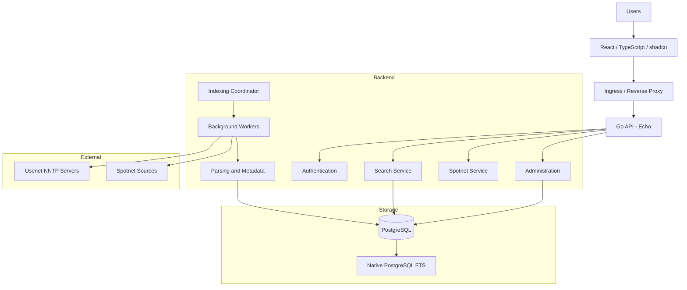

# Usenet + Spotnet Indexer — Comprehensive Implementation Plan

Version: 2.0 Backend: Go, Echo, Bun, pgx, errgroup Database: PostgreSQL with native Full-Text Search Frontend: React, TypeScript, Vite, shadcn/ui Deployment: Docker, Docker Compose, Kubernetes Architecture: Modular monolith with independently scalable API and worker services

# 1. Project Overview

## 1.1 Objective

Build a modern, scalable, self-hosted Usenet and Spotnet indexing platform.

The application will provide:

- NNTP server connectivity and management.
- Newsgroup discovery and management.
- Usenet article header ingestion.
- Spotnet source integration and post ingestion.
- Metadata extraction and normalization.
- Duplicate detection.
- PostgreSQL-powered full-text search.
- Advanced search filters and relevance ranking.
- Background indexing workers.
- Indexing job scheduling and monitoring.
- REST API for frontend and external integrations.
- Administrative dashboard.
- User authentication and authorization.
- Docker and Docker Compose support.
- Kubernetes deployment support.

The architecture must accommodate millions or potentially hundreds of millions of indexed records, depending on infrastructure capacity and database optimization.

## 1.2 Architectural principles

1. Performance-oriented database operations.
2. Modular and maintainable Go architecture.
3. Independently scalable API and worker services.
4. Concurrent processing using `errgroup`.
5. PostgreSQL as the primary persistence and search engine.
6. Bun as the primary ORM and query builder.
7. pgx as the PostgreSQL driver and high-performance ingestion interface.
8. Reliable, resumable, idempotent indexing.
9. Secure API and credential management.
10. Container-first deployment architecture.

# 2. Technology Stack

## 2.1 Backend

| Component | Technology |
| --- | --- |
| Language | Go |
| HTTP framework | Echo v4 |
| ORM / Query builder | Bun |
| Database | PostgreSQL |
| PostgreSQL driver | pgx v5 |
| Database connection pooling | database/sql with pgx stdlib |
| Concurrency | errgroup |
| Logging | slog |
| Configuration | Environment variables |
| Validation | go-playground/validator |
| Migrations | golang-migrate |
| API documentation | OpenAPI 3.1 |
| Authentication | JWT / secure sessions |
| Password hashing | Argon2id |
| Metrics | Prometheus |
| Tracing | OpenTelemetry |
| Testing | Go testing + testify |

## 2.2 Frontend

| Component | Technology |
| --- | --- |
| Framework | React |
| Language | TypeScript |
| Build tool | Vite |
| UI components | shadcn/ui |
| Styling | Tailwind CSS |
| Routing | React Router |
| Server state | TanStack Query |
| Forms | React Hook Form |
| Validation | Zod |
| Tables | TanStack Table |
| Icons | Lucide |
| Charts | Recharts |
| API client | Generated OpenAPI TypeScript client |
| Testing | Vitest |
| Component testing | React Testing Library |
| E2E testing | Playwright |

## 2.3 Infrastructure

| Component | Technology |
| --- | --- |
| Containerization | Docker |
| Local orchestration | Docker Compose |
| Production orchestration | Kubernetes |
| Kubernetes configuration | Kustomize |
| Container registry | GHCR |
| CI/CD | GitHub Actions |
| Ingress | NGINX Ingress |
| TLS | cert-manager |
| Monitoring | Prometheus |
| Dashboards | Grafana |
| Logging | Loki |
| Database backup | pgBackRest |
| Secrets | Kubernetes Secrets / External Secrets |

# 3. High-Level Architecture

Use a modular monolith with three independently deployable application components:

1. API service.
2. Background worker service.
3. Frontend service.

PostgreSQL is the central persistence layer and search engine.

mermaid



## 3.1 Backend architecture

text

```text
backend/
├── cmd/
│   ├── api/
│   │   └── main.go
│   ├── worker/
│   │   └── main.go
│   └── migrate/
│       └── main.go
│
├── internal/
│   ├── config/
│   ├── database/
│   │   ├── postgres.go
│   │   ├── migrations/
│   │   ├── models/
│   │   └── repositories/
│   │
│   ├── http/
│   │   ├── server.go
│   │   ├── middleware/
│   │   ├── handlers/
│   │   ├── requests/
│   │   └── responses/
│   │
│   ├── auth/
│   ├── users/
│   │
│   ├── usenet/
│   │   ├── client/
│   │   ├── connection/
│   │   ├── headers/
│   │   └── groups/
│   │
│   ├── spotnet/
│   │   ├── client/
│   │   ├── parser/
│   │   └── metadata/
│   │
│   ├── indexing/
│   │   ├── coordinator/
│   │   ├── scheduler/
│   │   ├── workers/
│   │   └── checkpoint/
│   │
│   ├── parser/
│   ├── metadata/
│   ├── search/
│   ├── categories/
│   ├── history/
│   ├── settings/
│   ├── admin/
│   └── observability/
│
└── pkg/
    ├── logger/
    ├── errors/
    └── pagination/
```

# 4. Functional Requirements

## FR-01: NNTP Server Management

Implement management of one or more Usenet NNTP servers.

Requirements:

- Add, edit, and remove NNTP servers.
- Enable and disable servers.
- Configure hostname and port.
- Support TLS connections.
- Support username/password authentication.
- Configure connection limits.
- Configure connection timeouts.
- Configure retry policies.
- Configure maximum concurrent connections.
- Configure server priorities.
- Test server connectivity.
- Track server connection status.
- Track server capabilities.
- Protect stored credentials.
- Never expose credentials through API responses or logs.

## FR-02: Newsgroup Management

Requirements:

- Discover available newsgroups.
- Store newsgroup names and metadata.
- Enable and disable groups.
- Track article ranges.
- Track first and last available article numbers.
- Track last successfully processed article number.
- Track last indexing timestamp.
- Detect article range changes.
- Support manual indexing.
- Support scheduled indexing.
- Configure indexing priority per group.

## FR-03: Usenet Ingestion

Implement the NNTP ingestion pipeline.

Requirements:

- Connect to configured NNTP servers.
- Retrieve article headers.
- Retrieve headers in configurable batches.
- Process large article ranges.
- Normalize article identifiers.
- Extract relevant header metadata.
- Handle malformed headers.
- Detect duplicate articles.
- Handle partial failures.
- Retry transient network errors.
- Save processing checkpoints.
- Resume interrupted indexing operations.
- Support incremental indexing.

Ingestion must be idempotent.

Processing the same article multiple times must not create duplicate indexed records.

## FR-04: Spotnet Integration

Implement a dedicated Spotnet ingestion module.

Requirements:

- Support configurable Spotnet sources.
- Support documented source interfaces and formats.
- Retrieve available Spotnet posts.
- Parse supported Spotnet formats.
- Extract post identifiers.
- Extract title and description.
- Extract posting date.
- Extract category.
- Extract author information where available.
- Extract related article identifiers.
- Normalize metadata.
- Validate parsed records.
- Detect duplicate posts.
- Track source synchronization status.
- Support incremental updates.
- Preserve source attribution.

The parser must be independent of the retrieval implementation to allow additional source formats.

## FR-05: Metadata Processing

Implement a reusable metadata processing pipeline.

Requirements:

- Normalize titles.
- Normalize whitespace.
- Normalize character encoding.
- Normalize dates to UTC.
- Extract available file metadata.
- Extract available content metadata.
- Support configurable category mappings.
- Store original metadata.
- Store normalized metadata.
- Track parsing failures.
- Support metadata reprocessing.
- Preserve source provenance.

## FR-06: Search Engine

Use PostgreSQL native Full-Text Search.

Requirements:

- Search titles.
- Search descriptions.
- Search normalized metadata.
- Search categories.
- Search newsgroups.
- Search by author where available.
- Search by date range.
- Search by source.
- Support multiple search terms.
- Support phrase searches.
- Support Boolean operators.
- Support exclusion terms.
- Support relevance ranking.
- Support sorting by relevance.
- Support sorting by date.
- Support sorting by title.
- Support pagination.
- Support result counts.
- Support faceted filtering.

PostgreSQL features:

- `tsvector`
- `tsquery`
- `websearch_to_tsquery`
- `plainto_tsquery`
- `phraseto_tsquery`
- `ts_rank_cd`
- GIN indexes
- `unaccent` extension

Suggested search weighting:

| Field | Weight |
| --- | --- |
| Title | A |
| Category | B |
| Description | C |
| Additional metadata | D |

Example:

sql

```sql
SELECT
    id,
    subject,
    ts_rank_cd(search_vector, query) AS rank
FROM articles,
     websearch_to_tsquery('simple', $1) AS query
WHERE search_vector @@ query
ORDER BY rank DESC
LIMIT $2;
```

Use parameterized SQL and Bun raw queries for advanced search functionality.

## FR-07: Search Filters

Support composable search filters:

- Category.
- Newsgroup.
- Source type.
- Posting date.
- Minimum and maximum size.
- Author.
- File type.
- Content type.
- Processing status.
- Custom metadata fields.

## FR-08: Category Management

Requirements:

- Create categories.
- Edit categories.
- Delete categories.
- Assign categories to records.
- Support hierarchical categories.
- Support automatic category mapping.
- Support manual category overrides.
- Support category aliases.

## FR-09: User Management

Requirements:

- User registration, configurable.
- Login and logout.
- Password hashing using Argon2id.
- Session management.
- Password reset.
- User profile management.
- Role-based access control.
- Administrator and regular-user roles.
- Account activation and deactivation.

## FR-10: Search History and Bookmarks

Requirements:

- Store search history.
- Clear search history.
- Save searches.
- Bookmark search results.
- Display recent searches.
- Configure history retention.

## FR-11: Administration

Provide an administrative interface for:

- Dashboard statistics.
- NNTP server management.
- Spotnet source management.
- Newsgroup management.
- Indexing job management.
- Worker status.
- Indexing progress.
- Failed job inspection.
- Retry failed jobs.
- Database statistics.
- User management.
- System settings.
- Application diagnostics.
- Audit logs.

## FR-12: Indexing Job Management

Requirements:

- Create indexing jobs.
- Schedule recurring jobs.
- Pause jobs.
- Resume jobs.
- Cancel jobs.
- Retry failed jobs.
- Track progress.
- Track processed records.
- Track failed records.
- Track execution duration.
- Configure worker concurrency.
- Prevent conflicting jobs from processing the same checkpoint simultaneously.
- Recover interrupted jobs.

## FR-13: REST API

Use Echo to implement a versioned REST API.

| Endpoint | Purpose |
| --- | --- |
| `/api/v1/auth` | Authentication |
| `/api/v1/users` | User management |
| `/api/v1/search` | Search |
| `/api/v1/items` | Indexed item details |
| `/api/v1/categories` | Categories |
| `/api/v1/servers` | NNTP servers |
| `/api/v1/groups` | Newsgroups |
| `/api/v1/spotnet` | Spotnet sources and posts |
| `/api/v1/indexing` | Indexing jobs |
| `/api/v1/admin` | Administration |
| `/api/v1/system` | System information |

API requirements:

- REST conventions.
- JSON request and response formats.
- Consistent error responses.
- Request validation.
- Pagination.
- Filtering.
- Authentication middleware.
- Authorization middleware.
- Rate limiting.
- OpenAPI documentation.
- API versioning.
- Health and readiness endpoints.

# 5. Database Design

Use PostgreSQL as the primary database.

Use Bun for ORM operations and query construction, with pgx for the underlying database driver and high-throughput PostgreSQL operations.

## 5.1 Core tables

### users

- id
- username
- email
- password\_hash
- role
- is\_active
- created\_at
- updated\_at

### nntp\_servers

- id
- name
- hostname
- port
- username
- encrypted\_password
- tls\_enabled
- max\_connections
- priority
- enabled
- created\_at
- updated\_at

### newsgroups

- id
- name
- description
- enabled
- first\_article\_number
- last\_article\_number
- last\_indexed\_article\_number
- last\_indexed\_at
- created\_at
- updated\_at

### articles

- id
- message\_id
- newsgroup\_id
- subject
- author
- posted\_at
- article\_size
- raw\_metadata
- normalized\_metadata
- search\_vector
- created\_at

Constraints:

- Appropriate unique constraints for article identity.
- Foreign key to newsgroups.
- Indexes on commonly filtered fields.

### spotnet\_posts

- id
- external\_id
- title
- description
- author
- category\_id
- posted\_at
- source\_id
- raw\_metadata
- normalized\_metadata
- search\_vector
- created\_at
- updated\_at

### spotnet\_sources

- id
- name
- source\_type
- configuration
- enabled
- last\_sync\_at
- created\_at
- updated\_at

### categories

- id
- name
- slug
- parent\_id
- created\_at
- updated\_at

### indexing\_jobs

- id
- job\_type
- source\_id
- newsgroup\_id
- status
- priority
- progress
- records\_processed
- records\_failed
- started\_at
- completed\_at
- created\_at

### indexing\_checkpoints

- id
- source\_id
- newsgroup\_id
- last\_processed\_position
- updated\_at

### user\_search\_history

- id
- user\_id
- search\_query
- filters
- created\_at

### bookmarks

- id
- user\_id
- item\_id
- created\_at

### system\_settings

- id
- setting\_key
- setting\_value
- updated\_at

## 5.2 Bun database implementation

Requirements:

- Configure Bun PostgreSQL dialect.
- Configure pgx v5 stdlib driver.
- Configure connection pooling.
- Implement Bun models.
- Implement repository interfaces.
- Implement transactions.
- Implement batch operations.
- Implement raw SQL execution.
- Implement database migrations.
- Implement database integration tests.

Use one database pool per application process, shared by repositories and services within that process.

Example database initialization:

go

```go
package database

import (
    "database/sql"

    "github.com/jackc/pgx/v5/stdlib"
    "github.com/uptrace/bun"
    "github.com/uptrace/bun/dialect/pgdialect"
)

func New(dsn string) (*bun.DB, error) {
    config, err := stdlib.ParseConfig(dsn)
    if err != nil {
        return nil, err
    }

    sqldb := stdlib.OpenDB(*config)

    db := bun.NewDB(
        sqldb,
        pgdialect.New(),
    )

    if err := sqldb.Ping(); err != nil {
        db.Close()
        return nil, err
    }

    return db, nil
}
```

Configure connection limits and timeouts explicitly.

## 5.3 Database performance

Implement:

- GIN indexes on search vectors.
- B-tree indexes on commonly filtered columns.
- Composite indexes for common queries.
- Unique indexes for deduplication.
- Partial indexes for active jobs.
- Foreign key constraints.
- Database constraints.
- Connection pooling.
- Prepared and parameterized queries.
- Bulk inserts using Bun.
- High-throughput ingestion using pgx COPY where justified.
- Transactional batch processing.

Evaluate table partitioning based on actual data volume and query patterns.

## 5.4 Search vector maintenance

Use PostgreSQL generated columns or triggers where appropriate.

Search vectors must be updated transactionally with their associated records.

Example:

sql

```sql
ALTER TABLE articles
ADD COLUMN search_vector tsvector;

CREATE INDEX idx_articles_search_vector
ON articles USING GIN (search_vector);
```

Implement weighted search vectors for title, author, category, and description.

# 6. Backend Architecture

## 6.1 Echo HTTP server

Use Echo for:

- Routing.
- Middleware.
- Request handling.
- Request validation.
- Authentication.
- Authorization.
- Error handling.
- HTTP logging.
- Rate limiting.
- Health checks.
- Graceful shutdown.

Required middleware:

- Request ID.
- Structured request logging.
- Panic recovery.
- CORS.
- Secure headers.
- Authentication.
- Authorization.
- Rate limiting.
- Request body limits.

## 6.2 Bun repository architecture

Use repository interfaces to isolate database implementation from business logic.

Required repositories:

- UserRepository.
- NNTPServerRepository.
- NewsgroupRepository.
- ArticleRepository.
- SpotnetPostRepository.
- SpotnetSourceRepository.
- CategoryRepository.
- IndexingJobRepository.
- CheckpointRepository.
- SearchRepository.
- SettingsRepository.

Business logic must not directly depend on Bun models or query-building details.

## 6.3 Concurrency with errgroup

Implement background workers using `errgroup.WithContext`.

Requirements:

- Bounded concurrency.
- Context cancellation.
- Graceful shutdown.
- Error propagation.
- Retry with exponential backoff.
- Per-server connection limits.
- Per-group processing coordination.
- Backpressure.
- Processing timeouts.
- Database connection limits.

Do not create an unbounded goroutine for every article.

Use bounded worker pools and separate concurrency limits for network retrieval, parsing, and database persistence.

## 6.4 Ingestion pipeline

Recommended processing architecture:

text

```text
NNTP / Spotnet Sources
         |
         v
Source Ingestion
         |
         v
Parsing and Validation
         |
         v
Metadata Normalization
         |
         v
Bounded Worker Pools
         |
         v
Batch Persistence
         |
         v
PostgreSQL
         |
         v
Full-Text Search
```

Requirements:

- Decouple network requests from database writes.
- Use bounded in-memory queues.
- Use idempotent persistence.
- Implement transactional checkpoints.
- Implement job ownership and leases.
- Avoid holding database transactions during network requests.

# 7. Frontend Requirements

Build a responsive application using React, TypeScript, Tailwind CSS, and shadcn/ui.

## 7.1 Main navigation

- Dashboard.
- Search.
- Categories.
- Newsgroups.
- Spotnet.
- Indexing.
- Servers.
- Users.
- Settings.
- System status.

Navigation visibility must depend on user permissions.

## 7.2 Dashboard

Display:

- Total indexed articles.
- Total Spotnet posts.
- Indexed newsgroups.
- Configured NNTP servers.
- Active indexing jobs.
- Failed jobs.
- Last successful indexing operation.
- Indexing throughput.
- Database size.
- Recent system events.

Use shadcn/ui cards, tables, badges, and charts.

## 7.3 Search interface

Requirements:

- Search input.
- Search suggestions.
- Advanced filters.
- Sorting.
- Pagination.
- Result counts.
- Relevance ranking.
- Responsive results.
- Search history.
- Saved searches.
- Empty states.
- Loading states.
- Error states.

Display:

- Title.
- Category.
- Source.
- Posting date.
- Author, where available.
- Size, where available.
- Relevant metadata.
- Relevance indicator.

## 7.4 Search details

Display:

- Complete metadata.
- Original source information.
- Article identifiers.
- Related Spotnet posts.
- Related indexed records.
- Posting information.
- Source provenance.

## 7.5 Server management

Provide:

- Server list.
- Configuration forms.
- Connectivity testing.
- Enable/disable controls.
- Connection statistics.
- Error information.
- Connection limits.

## 7.6 Newsgroup management

Provide:

- Newsgroup list.
- Search and filtering.
- Enable/disable controls.
- Article range information.
- Last indexed position.
- Indexing status.
- Manual indexing actions.

## 7.7 Indexing management

Provide:

- Active jobs.
- Queued jobs.
- Completed jobs.
- Failed jobs.
- Progress indicators.
- Job logs.
- Retry controls.
- Pause/resume controls.
- Concurrency configuration.

## 7.8 UI/UX requirements

- Responsive design.
- Dark and light themes.
- Accessible components.
- Keyboard navigation.
- Loading skeletons.
- Toast notifications.
- Confirmation dialogs.
- Form validation.
- Error boundaries.
- Consistent design tokens.

# 8. Non-Functional Requirements

## NFR-01: Performance

- Target sub-second search responses under normal operating conditions.
- Optimize queries using EXPLAIN ANALYZE.
- Use GIN indexes for full-text search.
- Support bulk ingestion.
- Avoid N+1 database queries.
- Use connection pooling.
- Implement bounded concurrency.
- Avoid unbounded memory growth.
- Use cursor-based pagination for deep result sets.

Performance targets must be validated against representative datasets and hardware.

## NFR-02: Scalability

- API and workers scale independently.
- Worker concurrency is configurable.
- Multiple worker replicas are supported.
- API supports horizontal scaling.
- PostgreSQL supports future partitioning and resource scaling.
- Processing pipelines avoid shared mutable state.

## NFR-03: Reliability

- Idempotent ingestion.
- Durable checkpoints.
- Automatic retry.
- Graceful shutdown.
- Transaction safety.
- Job recovery after restart.
- Protection against duplicate execution.
- Health and readiness checks.

## NFR-04: Security

- Argon2id password hashing.
- TLS for external connections.
- Secure credential storage.
- No secrets in source control.
- Input validation.
- SQL injection prevention.
- Rate limiting.
- Authentication and authorization.
- Secure HTTP headers.
- CORS configuration.
- Administrative audit logging.
- Dependency vulnerability scanning.
- Container security scanning.

## NFR-05: Observability

Implement:

- Structured JSON logging.
- Prometheus metrics.
- OpenTelemetry tracing.
- API request metrics.
- Database query metrics.
- Worker throughput metrics.
- Indexing failure metrics.
- NNTP connection metrics.
- Queue depth metrics.
- Health endpoints.

## NFR-06: Maintainability

- Modular packages.
- Clear interfaces.
- Dependency injection.
- Consistent error handling.
- Automated formatting.
- Static analysis.
- Unit and integration tests.
- API documentation.
- Versioned migrations.
- Developer documentation.

## NFR-07: Data Integrity

- Foreign key constraints.
- Unique constraints.
- Transactional writes.
- Idempotent upserts.
- Checkpoint consistency.
- Data retention policies.
- Backup and restore procedures.

## NFR-08: Compatibility

- Linux deployments.
- Docker-compatible runtimes.
- Docker Compose.
- Kubernetes.
- Modern desktop and mobile browsers.
- Supported PostgreSQL versions.

# 9. Docker and Docker Compose

## 9.1 Docker requirements

Create separate production-ready images for:

- Backend API.
- Background worker.
- Frontend.
- Database migrations.

Requirements:

- Multi-stage builds.
- Minimal runtime images.
- Non-root execution.
- Read-only filesystem where practical.
- Health checks.
- Proper signal handling.
- No embedded secrets.
- Environment-based configuration.
- Versioned image tags.

## 9.2 Docker Compose architecture

Required services:

1. PostgreSQL.
2. Backend API.
3. Indexing worker.
4. Frontend.
5. Migration service.
6. Prometheus.
7. Grafana.

Optional development services:

- pgAdmin.
- Loki.
- Promtail.

## 9.3 Docker Compose requirements

- Persistent PostgreSQL volume.
- Application network.
- Environment-based configuration.
- Database readiness checks.
- Controlled migration execution.
- Service dependency management.
- Restart policies.
- Health checks.
- Development and production overrides.

Expected commands:

bash

```bash
docker compose up -d
docker compose logs -f api
docker compose logs -f worker
docker compose down
```

Provide `.env.example` with all configurable environment variables and placeholder values.

# 10. Kubernetes Support

Use Kustomize for Kubernetes deployment configuration.

## 10.1 Required resources

- Namespace.
- ConfigMaps.
- Secrets.
- API Deployment.
- Worker Deployment.
- Frontend Deployment.
- Services.
- Ingress.
- PersistentVolumeClaim.
- ServiceAccount.
- Role and RoleBinding where required.
- HorizontalPodAutoscaler.
- PodDisruptionBudget.
- NetworkPolicy.
- ResourceQuota where appropriate.

## 10.2 Kubernetes architecture

### API deployment

- Multiple replicas.
- Readiness probe.
- Liveness probe.
- Resource requests and limits.
- Rolling updates.
- Horizontal autoscaling.

### Worker deployment

- Independently configurable replicas.
- Graceful shutdown.
- Configurable concurrency.
- Resource requests and limits.
- Job coordination through PostgreSQL.
- Restart recovery.

### PostgreSQL

For development, provide a PostgreSQL StatefulSet with persistent storage.

For production, prefer managed PostgreSQL or a properly operated PostgreSQL HA solution.

Requirements:

- Automated backups.
- Restore procedures.
- Persistent storage.
- Database monitoring.
- Connection limits.
- Migration management.

## 10.3 Kubernetes directory structure

text

```text
deployments/kubernetes/
├── base/
│   ├── namespace.yaml
│   ├── configmap.yaml
│   ├── api-deployment.yaml
│   ├── api-service.yaml
│   ├── worker-deployment.yaml
│   ├── frontend-deployment.yaml
│   ├── frontend-service.yaml
│   ├── ingress.yaml
│   ├── hpa.yaml
│   ├── pdb.yaml
│   ├── network-policy.yaml
│   └── kustomization.yaml
│
└── overlays/
    ├── development/
    │   └── kustomization.yaml
    └── production/
        ├── kustomization.yaml
        ├── replicas.yaml
        └── resources.yaml
```

Deployment command:

bash

```bash
kubectl apply -k deployments/kubernetes/overlays/development
```

# 11. Testing Strategy

## 11.1 Backend unit tests

Test:

- NNTP client.
- Header parsing.
- Spotnet parsing.
- Metadata normalization.
- Search query construction.
- Category mapping.
- Authentication.
- Authorization.
- Job coordination.
- Retry policies.
- Checkpoint handling.

## 11.2 Database integration tests

Use a dedicated PostgreSQL instance.

Test:

- Database migrations.
- Bun repository operations.
- pgx COPY ingestion.
- Bulk inserts.
- Duplicate detection.
- Full-text search.
- Search ranking.
- Filtering.
- Transactions.
- Concurrent writes.
- Job recovery.

## 11.3 Frontend tests

Test:

- Authentication.
- Navigation.
- Search forms.
- Search results.
- Filters.
- Server management.
- Indexing controls.
- Form validation.
- Error handling.
- Responsive layouts.

## 11.4 End-to-end tests

Use Playwright.

Important scenarios:

1. Administrator logs in.
2. Administrator configures an NNTP server.
3. Administrator tests connectivity.
4. Administrator enables a newsgroup.
5. Administrator starts indexing.
6. Worker retrieves and processes headers.
7. Data is stored in PostgreSQL.
8. Search returns indexed records.
9. User filters results.
10. Administrator inspects job status.

## 11.5 Performance tests

Use k6 or an equivalent load-testing tool.

Measure:

- Search latency.
- API throughput.
- Database query latency.
- Concurrent users.
- Ingestion throughput.
- Worker memory consumption.
- PostgreSQL connection utilization.

Test with progressively larger datasets.

# 12. CI/CD Pipeline

Use GitHub Actions.

Pipeline stages:

1. Checkout.
2. Dependency installation.
3. Go formatting verification.
4. Go linting.
5. Go unit tests.
6. Frontend linting.
7. Frontend type checking.
8. Frontend unit tests.
9. Backend integration tests.
10. Frontend build.
11. Docker image build.
12. Container vulnerability scanning.
13. Image publishing.
14. Deployment.

Build separate images:

- `indexer-api`
- `indexer-worker`
- `indexer-frontend`
- `indexer-migrate`

Use immutable image tags based on Git commit SHA.

Production deployment must include migration compatibility checks and rollback planning.

# 13. Development Phases

## Phase 0 — Architecture and Project Foundation

Objective: Establish the project structure and technical foundations.

- [ ]Finalize application architecture.
- [ ]Define backend package boundaries.
- [ ]Define frontend structure.
- [ ]Create Git repository.
- [ ]Configure Go modules.
- [ ]Initialize Echo.
- [ ]Initialize Bun.
- [ ]Configure pgx v5.
- [ ]Configure React, TypeScript, and Vite.
- [ ]Install shadcn/ui.
- [ ]Configure Tailwind CSS.
- [ ]Establish coding standards.
- [ ]Configure environment variables.
- [ ]Create Docker development environment.
- [ ]Create initial Docker Compose configuration.
- [ ]Establish CI pipeline.
- [ ]Write architecture documentation.

Deliverable: Running application skeleton with backend, frontend, PostgreSQL, and containers.

## Phase 1 — Database Foundation

Objective: Implement the database schema and data access layer.

- [ ]Configure PostgreSQL.
- [ ]Configure pgx stdlib.
- [ ]Configure Bun PostgreSQL dialect.
- [ ]Configure database connection pooling.
- [ ]Configure database migrations.
- [ ]Create core database tables.
- [ ]Define Bun models.
- [ ]Implement repository interfaces.
- [ ]Add foreign key constraints.
- [ ]Add unique constraints.
- [ ]Add initial indexes.
- [ ]Implement transaction helpers.
- [ ]Implement batch operations.
- [ ]Implement pgx COPY integration.
- [ ]Add database integration tests.

Deliverable: Functional database layer using Bun and pgx.

## Phase 2 — Backend API Foundation

Objective: Implement the HTTP API.

- [ ]Configure Echo.
- [ ]Implement dependency injection.
- [ ]Implement configuration loading.
- [ ]Implement structured logging.
- [ ]Implement middleware.
- [ ]Implement request validation.
- [ ]Implement consistent API errors.
- [ ]Implement health endpoints.
- [ ]Implement readiness endpoints.
- [ ]Implement API versioning.
- [ ]Generate OpenAPI specification.
- [ ]Add API integration tests.

Deliverable: Functional Go API foundation using Echo.

## Phase 3 — Authentication and Authorization

Objective: Implement secure user access.

- [ ]Implement user repository.
- [ ]Implement password hashing.
- [ ]Implement login.
- [ ]Implement logout.
- [ ]Implement session or token management.
- [ ]Implement role-based authorization.
- [ ]Implement user administration.
- [ ]Implement password reset.
- [ ]Add security middleware.
- [ ]Add authentication tests.

Deliverable: Secure authentication and user management.

## Phase 4 — Usenet Integration

Objective: Implement NNTP connectivity and article ingestion.

- [ ]Implement NNTP client abstraction.
- [ ]Implement server configuration.
- [ ]Implement TLS support.
- [ ]Implement authentication.
- [ ]Implement bounded connection management.
- [ ]Implement server connectivity testing.
- [ ]Implement newsgroup discovery.
- [ ]Implement newsgroup management.
- [ ]Implement header retrieval.
- [ ]Implement batch processing.
- [ ]Implement article parsing.
- [ ]Implement duplicate detection.
- [ ]Implement checkpoint persistence.
- [ ]Implement incremental indexing.
- [ ]Implement retry policies.
- [ ]Implement integration tests.

Deliverable: Functional Usenet ingestion pipeline.

## Phase 5 — Spotnet Integration

Objective: Implement Spotnet source management and ingestion.

- [ ]Define supported Spotnet source interfaces.
- [ ]Implement source configuration.
- [ ]Implement source connectivity checks.
- [ ]Implement retrieval adapters.
- [ ]Implement post parsing.
- [ ]Implement metadata extraction.
- [ ]Implement normalization.
- [ ]Implement duplicate detection.
- [ ]Implement source synchronization.
- [ ]Implement checkpoint management.
- [ ]Implement failure handling.
- [ ]Implement parser tests.
- [ ]Implement integration tests.

Deliverable: Functional Spotnet ingestion module.

## Phase 6 — Metadata and Indexing Engine

Objective: Build the concurrent processing and persistence pipeline.

- [ ]Implement metadata normalization interfaces.
- [ ]Implement category mapping.
- [ ]Implement processing workers.
- [ ]Implement bounded worker pools.
- [ ]Integrate errgroup.
- [ ]Implement job scheduling.
- [ ]Implement job coordination.
- [ ]Implement job persistence.
- [ ]Implement checkpoint recovery.
- [ ]Implement idempotent persistence.
- [ ]Implement Bun batch writes.
- [ ]Implement pgx COPY for high-volume ingestion.
- [ ]Implement graceful shutdown.
- [ ]Implement retry and backoff.
- [ ]Implement job statistics.
- [ ]Implement worker tests.

Deliverable: Reliable concurrent indexing engine.

## Phase 7 — PostgreSQL Search Engine

Objective: Implement native full-text search.

- [ ]Design search document structure.
- [ ]Implement weighted tsvector generation.
- [ ]Implement GIN indexes.
- [ ]Configure text search dictionaries.
- [ ]Integrate unaccent where appropriate.
- [ ]Implement websearch\_to\_tsquery.
- [ ]Implement phrase and Boolean searches.
- [ ]Implement relevance ranking.
- [ ]Implement filtering.
- [ ]Implement pagination.
- [ ]Implement sorting.
- [ ]Implement faceted results.
- [ ]Optimize common queries.
- [ ]Benchmark representative datasets.
- [ ]Add search integration tests.

Deliverable: Functional PostgreSQL search engine.

## Phase 8 — Frontend Foundation

Objective: Build the main frontend application.

- [ ]Configure React Router.
- [ ]Configure TanStack Query.
- [ ]Configure API client.
- [ ]Configure generated API types.
- [ ]Implement application layouts.
- [ ]Implement sidebar navigation.
- [ ]Implement header.
- [ ]Implement authentication pages.
- [ ]Implement user profile.
- [ ]Implement dark and light themes.
- [ ]Implement reusable UI components.
- [ ]Implement error boundaries.
- [ ]Implement notifications.

Deliverable: Functional frontend foundation.

## Phase 9 — Search and Discovery Interface

Objective: Build the primary user-facing search experience.

- [ ]Implement search page.
- [ ]Implement search input.
- [ ]Implement advanced filters.
- [ ]Implement result list.
- [ ]Implement result details.
- [ ]Implement pagination.
- [ ]Implement sorting.
- [ ]Implement category filters.
- [ ]Implement date filters.
- [ ]Implement search history.
- [ ]Implement bookmarks.
- [ ]Implement saved searches.
- [ ]Implement responsive layouts.
- [ ]Add frontend tests.

Deliverable: Complete search and discovery experience.

## Phase 10 — Administration Interface

Objective: Build system administration features.

- [ ]Implement dashboard.
- [ ]Implement statistics cards.
- [ ]Implement system charts.
- [ ]Implement NNTP server management.
- [ ]Implement newsgroup management.
- [ ]Implement Spotnet source management.
- [ ]Implement indexing job management.
- [ ]Implement worker monitoring.
- [ ]Implement job retry controls.
- [ ]Implement category management.
- [ ]Implement user management.
- [ ]Implement system settings.
- [ ]Implement error and event views.

Deliverable: Complete administrative interface.

## Phase 11 — Docker and Kubernetes

Objective: Prepare production deployment.

- [ ]Create backend multi-stage Dockerfile.
- [ ]Create frontend Dockerfile.
- [ ]Create migration image.
- [ ]Create production Docker Compose configuration.
- [ ]Add persistent PostgreSQL volumes.
- [ ]Add container health checks.
- [ ]Configure resource constraints.
- [ ]Create Kubernetes namespace.
- [ ]Create ConfigMaps.
- [ ]Configure Secrets integration.
- [ ]Create API Deployment.
- [ ]Create worker Deployment.
- [ ]Create frontend Deployment.
- [ ]Create Services.
- [ ]Create Ingress.
- [ ]Create HPA.
- [ ]Create PodDisruptionBudget.
- [ ]Create NetworkPolicies.
- [ ]Configure development PostgreSQL storage.
- [ ]Configure database backups.
- [ ]Document deployment and upgrade procedures.

Deliverable: Fully containerized application deployable using Docker Compose and Kubernetes.

## Phase 12 — Observability and Performance

Objective: Prepare the application for production workloads.

- [ ]Add Prometheus metrics.
- [ ]Add OpenTelemetry instrumentation.
- [ ]Add Grafana dashboards.
- [ ]Add structured logging.
- [ ]Add log aggregation.
- [ ]Monitor API latency.
- [ ]Monitor database connections.
- [ ]Monitor ingestion throughput.
- [ ]Monitor worker utilization.
- [ ]Monitor indexing failures.
- [ ]Run load tests.
- [ ]Optimize SQL queries.
- [ ]Tune PostgreSQL configuration.
- [ ]Validate memory consumption.
- [ ]Validate horizontal scaling.
- [ ]Document operational thresholds.

Deliverable: Observable and performance-tested application.

## Phase 13 — Security, Hardening and Release

Objective: Finalize the production release.

- [ ]Perform dependency security scans.
- [ ]Perform container image scans.
- [ ]Review authentication and authorization.
- [ ]Review secret management.
- [ ]Review API rate limiting.
- [ ]Review input validation.
- [ ]Test backup and restoration.
- [ ]Test failure recovery.
- [ ]Test graceful shutdown.
- [ ]Perform end-to-end testing.
- [ ]Perform deployment testing.
- [ ]Write production operations documentation.
- [ ]Write administrator documentation.
- [ ]Write user documentation.
- [ ]Tag initial stable release.

Deliverable: Production-ready initial release.

# 14. Monitoring and Metrics

Expose the following Prometheus metrics:

| Metric | Description |
| --- | --- |
| `indexer_articles_processed_total` | Total processed articles |
| `indexer_spotnet_posts_processed_total` | Total processed Spotnet posts |
| `indexer_processing_errors_total` | Processing failures |
| `indexer_jobs_active` | Active indexing jobs |
| `indexer_jobs_failed_total` | Failed jobs |
| `indexer_worker_utilization` | Worker utilization |
| `indexer_nntp_connections_active` | Active NNTP connections |
| `indexer_ingestion_duration_seconds` | Processing duration |
| `indexer_search_duration_seconds` | Search execution time |
| `indexer_database_connections_active` | Active database connections |

Create Grafana dashboards for:

- Application health.
- API performance.
- PostgreSQL performance.
- NNTP connectivity.
- Indexing throughput.
- Worker performance.
- Search performance.

# 15. Backup and Disaster Recovery

Requirements:

- Automated PostgreSQL backups.
- Periodic backup verification.
- Point-in-time recovery where supported.
- Database restore documentation.
- Persistent storage monitoring.
- Configuration backup.
- Recovery procedures for interrupted indexing.
- Durable job checkpoints.
- Defined recovery time objective (RTO).
- Defined recovery point objective (RPO).

# 16. Content Governance

Requirements:

- Respect applicable source terms and access restrictions.
- Maintain source attribution.
- Maintain provenance for indexed records.
- Provide an administrative takedown workflow.
- Support exclusion and block lists.
- Support configurable retention policies.
- Prevent unauthorized access to restricted sources.
- Provide audit logs for moderation actions.
- Avoid exposing credentials or private source configuration.
- Define policies for copyrighted, illegal, and otherwise restricted material.

# 17. Definition of Done

The initial production release is complete when:

- [ ]Go backend builds successfully.
- [ ]Echo API works.
- [ ]Bun database integration works.
- [ ]pgx integration works.
- [ ]React frontend builds successfully.
- [ ]PostgreSQL migrations execute successfully.
- [ ]NNTP server management works.
- [ ]Newsgroup discovery works.
- [ ]Usenet ingestion works.
- [ ]Spotnet ingestion works for supported formats.
- [ ]Metadata parsing and normalization work.
- [ ]Duplicate detection works.
- [ ]Checkpoints survive restarts.
- [ ]Concurrent processing works reliably.
- [ ]PostgreSQL full-text search works.
- [ ]Search ranking and filters work.
- [ ]Authentication and authorization work.
- [ ]Administrative dashboard works.
- [ ]Indexing management works.
- [ ]Docker Compose deployment works.
- [ ]Kubernetes deployment works.
- [ ]Monitoring and health checks work.
- [ ]Automated tests pass.
- [ ]Backup and restore procedures are verified.
- [ ]Security review is completed.
- [ ]Documentation is available.

# 18\. Recommended Implementation Priorities

| Priority | Component | Reason |
| --- | --- | --- |
| P0 | Project foundation | Establishes architecture |
| P0 | Bun + pgx database layer | Required by all subsystems |
| P0 | NNTP integration | Core ingestion capability |
| P0 | Indexing engine | Core processing capability |
| P0 | PostgreSQL FTS | Core search capability |
| P1 | Spotnet integration | Second ingestion source |
| P1 | Echo REST API | Exposes application functionality |
| P1 | Search frontend | Primary user experience |
| P1 | Administration | Operational management |
| P1 | Docker Compose | Repeatable deployment |
| P2 | Kubernetes | Production orchestration |
| P2 | Observability | Production operations |
| P2 | Advanced analytics | Operational insights |
| P2 | Performance optimization | Large-scale readiness |

# 19\. Final Architecture Decisions

The initial architecture will consist of:

### API service

- Go.
- Echo.
- Bun.
- pgx.
- Authentication and authorization.
- Search API.
- User management.
- Administration API.

### Worker service

- Go.
- Bun.
- pgx.
- errgroup.
- NNTP ingestion.
- Spotnet ingestion.
- Parsing and metadata processing.
- Indexing jobs.
- Checkpoint management.

### Frontend service

- React.
- TypeScript.
- Vite.
- shadcn/ui.
- Tailwind CSS.
- TanStack Query.

### Database

- PostgreSQL.
- Native Full-Text Search.
- GIN indexes.
- Bun ORM.
- pgx driver.
- Transactional checkpoints.
- PostgreSQL-backed job coordination.

### Deployment

- Docker.
- Docker Compose.
- Kubernetes.
- Kustomize.
- Prometheus.
- Grafana.

Important implementation decision: Bun should be the primary database abstraction, while pgx should provide the underlying PostgreSQL driver through its stdlib adapter. For exceptionally high-volume ingestion, use pgx COPY directly where benchmarks demonstrate a meaningful advantage. Keep one connection pool per application process.

Avoid introducing Kafka, Redis, Elasticsearch, or OpenSearch until actual operational requirements justify their additional complexity.

The result should be a maintainable, performant, self-hosted indexing platform with a clear path toward distributed workers and large-scale indexing.
